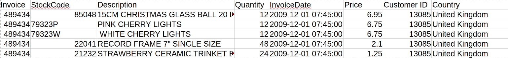
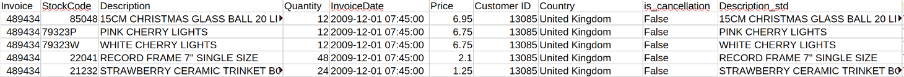
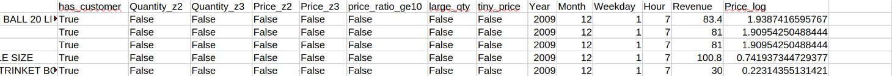
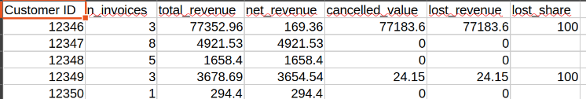

# Data Wrangling on E-commerce Data

This is a cleaning and profiling project on the Online Retail II dataset (1,067,371 rows, 8 columns: `Invoice`, `StockCode`, `Description`, `Quantity`, `InvoiceDate`, `Price`, `Customer ID`, `Country`). Everything lives in one notebook, `main.ipynb`.

It takes the raw CSV, cleans it, and produces two tables: a cleaned line-item table and a customer table. At the end it also checks how much revenue is lost when a customer cancels an order and never buys the product again.

## What the notebook does

1. **Profiling**: look at the raw data (missing values, types, duplicates, odd stock codes, zero and negative prices and quantities). A copy of the raw data, `dt_raw`, stays untouched for before/after comparisons.
2. **Structuring**: fix types, tidy text, rename a few countries, add flags. No rows are removed here.
3. **Cleansing**: five rules that remove rows (below).
4. **Outlier flagging**: z-scores and a price-vs-product-median check. Outliers are flagged, not deleted.
5. **Enrichment**: date features, `Revenue`, `Price_log`, a country × month pivot, and the customer table.
6. **Result**: before/after comparison, saved files, charts.

## Rows that get removed

- exact duplicate rows
- non-product stock codes (`POST`, `DOT`, `M`, `B`, `AMAZONFEE`, gift vouchers, etc.)
- zero price
- negative price
- negative quantity on invoices that are not cancellations

Cancellation invoices (starting with `C`) stay in, because their negative quantities are legitimate and the cancellation analysis needs them.

Some things are fixed without removing anything: `StockCode` is uppercased, `EIRE` / `RSA` / `USA` are renamed, and `Unspecified` in `Country` is set to missing. Description variants within a stock code are matched with `fuzz.ratio` (score >= 95) and written to `Description_std`. The original `Description` is kept.

## Flags

| Flag | Meaning |
|---|---|
| `has_customer` | row has a `Customer ID` |
| `Quantity_z2/z3`, `Price_z2/z3` | z-score >= 2 or >= 3 |
| `price_ratio_ge10` | price at least 10× the product median (products with 10+ rows) |
| `large_qty` | quantity >= 10,000 |
| `tiny_price` | price < 0.01 (17 `PADS` rows at 0.001) |

I flagged instead of deleting because the high prices mostly belong to rows without a `Customer ID` (a second price level), and the biggest quantities (−80,995 and −74,215) are order/cancellation pairs that net to zero.

## Before and after

| | raw | clean |
|---|---|---|
| Rows | 1,067,371 | 1,021,272 (−4.32 %) |
| `Price` std | 123.55 | 4.87 |
| `Price` min / max | −53,594.36 / 38,970 | 0.001 / 1,157.15 |
| Missing `Description` | 4,382 | 0 |
| Missing `Customer ID` | 243,007 (22.77 %) | 227,089 (22.24 %) |
| Distinct `StockCode` | 5,305 | 4,739 |

## Cancellations and lost revenue

For every canceled line of a known customer, the notebook checks whether the same customer bought the same product later. There are two versions: a loose one (any later purchase counts) and a strict one (bought again within the window, and it was the only later purchase). Windows run from 1 hour to 1 year.

A canceled line counts as lost if it wasn't rebought in the window. The defaults are the strict rule and a 3-month window, set by `LOST_RULE` and `LOST_WINDOW` in the notebook. Cancellations without a full follow-up window before the end of the data are skipped.

## Output

- `output`: one row per line item, with the flag and date columns added.
- `output`: one row per customer (`n_invoices`, `total_revenue`, `net_revenue`, `cancelled_value`, `lost_revenue`, `lost_share`).
- `figures`: the charts as PNGs.

## Datasets

### Raw Online Retail II Dataset


### Clean Online Retail II Dataset



### Created Customers Dataset


## Running it

Folder layout:

```
main.ipynb
requirements.txt
.gitignore
assets/
figures/
README.md
```

## Installation

```commandline
pip install -r requirements.txt
```

> [!NOTE]
> The notebook uses f-strings with nested quotes and the `orientation` argument of `boxplot`, so it needs Python 3.12+ and matplotlib 3.10+.

## Known limits

- Keeping the duplicates would raise net revenue by about 466k, so that rule has a real effect.
- `Customer ID` is still missing in 22.24 % of clean rows. I didn't impute it, because an ID can't be estimated and the missing rows are tied to the second price level.
- 67 customers (1.13 %) have no rows left after cleansing, so customer-level analysis leaves them out.
- Fuzzy matching can't tell a typo from a real rename or a different product under the same code.
- 9 of the `large_qty` rows are unpaired large orders that can't be checked from the data.
- `Korea`, `Channel Islands` and `West Indies` were left as they are, because the data doesn't say which country or island they mean.
- No scaling, imputation or binning was applied. The notebook explains why for each one.

## Reference

- Chen, D. (2012). *Online Retail II* [Data set]. UCI Machine Learning Repository. https://doi.org/10.24432/C5CG6D
- mashlyn. (n.d.). *Online Retail II UCI* [Data set]. Kaggle. https://www.kaggle.com/mashlyn/online-retail-ii-uci
- Rattenbury, T., Hellerstein, J. M., Heer, J., Kandel, S., & Carreras, C. (2017). *Principles of data wrangling: Practical techniques for data preparation*. O'Reilly Media.
- Wickham, H. (2014). Tidy data. *Journal of Statistical Software, 59*(10), 1–23. https://doi.org/10.18637/jss.v059.i10

## Authors

[Anri Stepanian](https://github.com/anristepanian)
